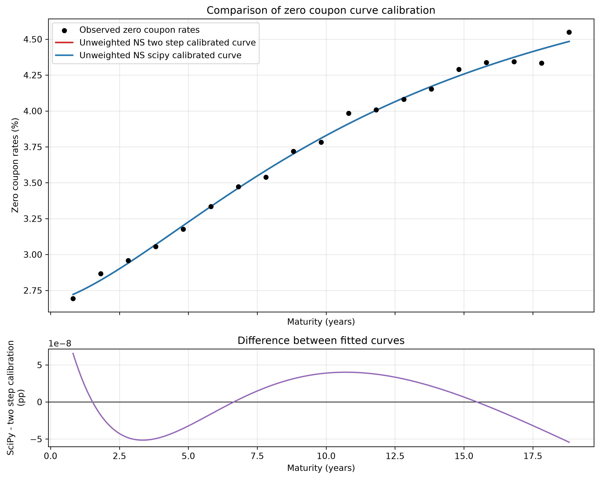
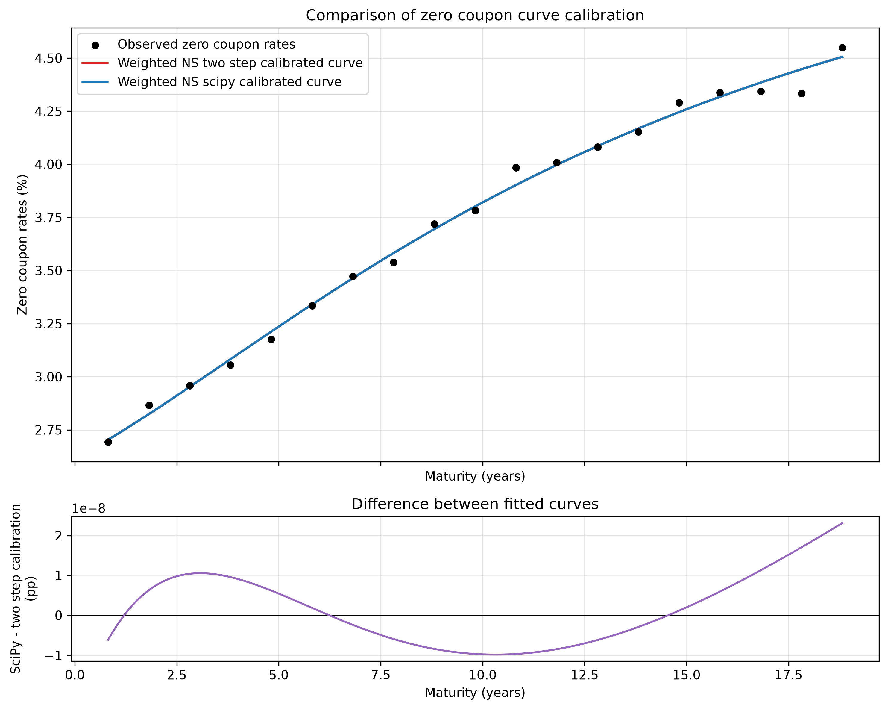
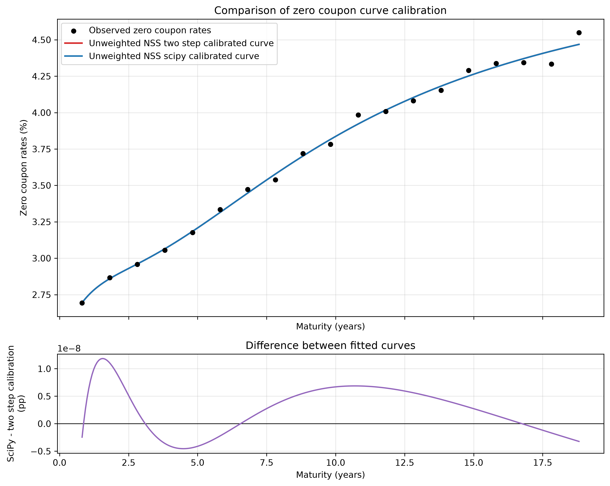
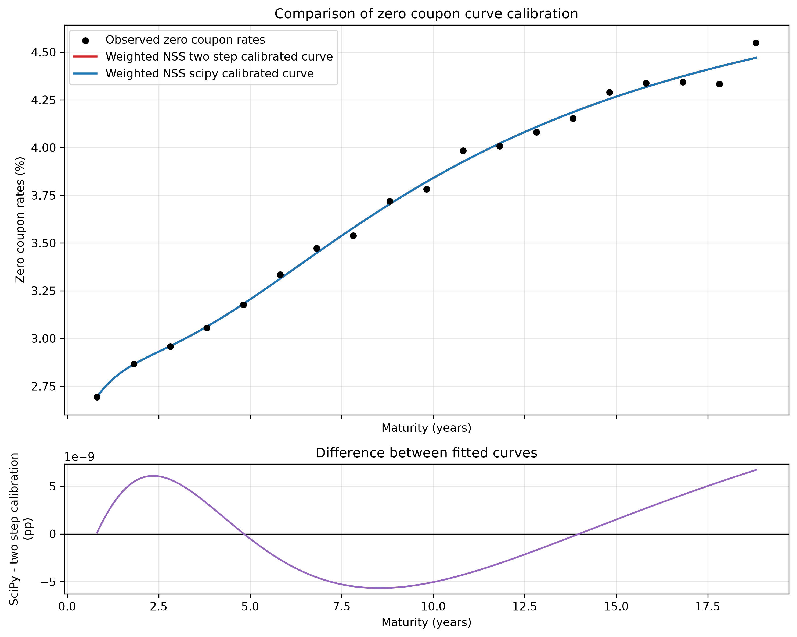

# Nelson-Siegel-Svensson Calibration of Zero-Coupon Curves: French OATs and OIS (€STR, SOFR)

## Why this project?

A bootstrapped zero-coupon curve only gives rates at the maturities of the instruments it was built from. Pricing, hedging or risk work needs the rate at *any* maturity *t*, not only at those points.

**The question: how can we turn a discrete set of bootstrapped zero-coupon rates into a smooth, continuous curve, how well does a parsimonious model fit very different curves, and can we trust the parameters that come out of it?**

## Approach

I fit the **Nelson-Siegel (NS)** and **Nelson-Siegel-Svensson (NSS)** models to zero-coupon curves produced by my own from-scratch bootstrap ([Zero-Coupon Yield Curve Bootstrap](https://github.com/Target-Justin/Zero-Coupon-Yield-Curve-Bootstrap)), on two very different datasets:

- **French OATs**: 19 government bonds maturing between 2027 and 2045, one valuation date (public data, included);
- **OIS curves**: €STR and SOFR swaps from 1 week to 50 years, 7 valuation dates between 2021 and 2026 (Bloomberg data, *not* included).

Each fit is calibrated with two independent methods (a custom two-step method and a joint `scipy` optimization) and with or without weights: inverse duration for the OATs, inverse squared bid-ask spread for the OIS.

## Highlights

- **The two calibration methods agree**: fitted curves differ by less than 10⁻⁵ bp on the OATs and by less than 0.01 bp on all 52 OIS fits.
- **NS is not enough for a 1W–50Y OIS curve**: median maximum error of 43 bp, against **4.8 bp** for NSS (median RMSE 2.3 bp).
- **The weighting decides where the error goes**: the inverse-duration weighting used for bonds would give the 1-week OIS pillar about 2,600 times the weight of the 50-year pillar, so the OIS fits use bid-ask weights instead. Even then, weighting moves the error to the long end (median 8.6 bp beyond 15 years, against 4.6 bp unweighted).
- **Finding the global optimum is the hard part**: with λ grids designed for 1–19-year OATs, some OIS fits stopped in local minima up to 70 bp away from the data, while a brute-force search showed that NSS can fit the same curves within 3–6 bp. See [Lessons on Identifiability and Optimization](#lessons-on-identifiability-and-optimization).

## Context

This project was built as part of my search for a work-study position (*alternance*) in quantitative finance, with a focus on fixed income and credit.

## Contents

- [Data](#data)
- [Model](#model)
- [Calibration Methods](#calibration-methods)
- [Weighting Schemes](#weighting-schemes)
- [Project Structure](#project-structure)
- [Usage](#usage)
- [Results: French OATs](#results-french-oats)
- [Results: OIS Curves](#results-ois-curves)
- [Lessons on Identifiability and Optimization](#lessons-on-identifiability-and-optimization)
- [Limitations and Next Steps](#limitations-and-next-steps)
- [Data Availability](#data-availability)
- [Requirements](#requirements)
- [References](#references)

## Data

All zero-coupon curves come from my bootstrap project ([link](https://github.com/Target-Justin/Zero-Coupon-Yield-Curve-Bootstrap)).

### French OATs (included)

**Sources:** Euronext (clean prices) and Agence France Trésor (bond characteristics). Valuation date: 2026-07-29.

The OAT pipeline reads four files in `data/raw/bonds/`:

- `dataset.csv`: bond characteristics (maturity, valuation date, coupon, day-count convention, etc.)
- `cashflow.csv`: coupon and principal cash flows for each bond and payment date
- `dirty_price.csv`: dirty prices, computed as Euronext clean prices plus accrued interest
- `zero_rate.csv`: bootstrapped zero-coupon rates of the 19 OATs, used as the calibration target

### OIS curves (not included)

**Source:** Bloomberg curve exports for €STR and SOFR overnight indexed swaps, bootstrapped in the bootstrap project. The quotes cannot be redistributed, and neither can anything derived from them (zero rates, fitted curves, parameters, plots): see [Data Availability](#data-availability).

- 2 indices × 7 valuation dates: 2021-06-30, 2022-06-30, 2022-12-30, 2023-03-31, 2023-10-31, 2024-12-30, 2026-10-02
- 32 pillars per curve, from 1 week to 50 years (the overnight rate is excluded)
- time to maturity in ACT/360 from the settlement date (T+2 business days), continuously compounded zero rates

The OIS pipeline reads a single long-format file, `data/raw/ois/zero_rate.csv`, produced by the bootstrap project (`results/ois/zero_rate.csv`), with one row per curve, date and pillar:

| Column | Description |
|---|---|
| `Curve` | `ESTR` or `SOFR` |
| `EvaluationDate` | market data date (`YYYY-MM-DD`) |
| `SettlementDate` | evaluation date + 2 business days; origin of times and discount factors |
| `Ticker` | pillar identifier |
| `Maturity` | pillar maturity date |
| `TimeToMaturity` | year fraction from `SettlementDate`, ACT/360 |
| `DiscountFactor` | bootstrapped discount factor |
| `ZeroCouponRate`, `ZeroCouponRatePct` | continuously compounded zero rate, in decimal and in % |
| `Bid`, `Ask` | par swap rate quotes, in % |
| `BidAskSpreadBp` | `Ask - Bid`, in basis points |

> **Data check.** The €STR export labelled 2021-06-30 failed a sanity check: its rate levels are inconsistent with that date (€STR was negative in mid-2021) and match a later date. It is excluded from all the OIS statistics below until it is re-extracted. The figures therefore cover **13 curves** (6 €STR, 7 SOFR).

### Bond metrics (OAT only)

For each bond, let `CF_k` be the cash flows paid at times `t_k` (in years from the settlement date). The **yield to maturity** `y` (continuous compounding) solves:

```text
P_dirty = Σ_k CF_k · exp(-y · t_k)
```

This equation is solved with Newton-Raphson (`scripts/bonds/bond_metrics/yield_to_maturity.py`):

```text
f(y)    = Σ_k CF_k · exp(-y · t_k) - P_dirty
f'(y)   = -Σ_k t_k · CF_k · exp(-y · t_k)
y_{n+1} = y_n - f(y_n) / f'(y_n)
```

The **Macaulay duration** (`scripts/bonds/bond_metrics/duration.py`) is the present-value-weighted average time of the cash flows:

```text
D = (1 / P_dirty) · Σ_k t_k · CF_k · exp(-y · t_k)
```

Under continuous compounding it equals the modified duration, `-(1/P) · dP/dy`. It is used to build the OAT weights described in [Weighting Schemes](#weighting-schemes).

## Model

The zero-coupon rate at maturity `t` is a combination of level, slope and curvature factors:

```text
y(t) = β1 + β2 · x_1(t) + β3 · x_2(t) + β4 · x_3(t)      (β4 · x_3 : NSS only)
```

with the factor loadings:

```text
x_1(t) = (1 - exp(-t/λ1)) / (t/λ1)                    slope
x_2(t) = (1 - exp(-t/λ1)) / (t/λ1) - exp(-t/λ1)       first curvature
x_3(t) = (1 - exp(-t/λ2)) / (t/λ2) - exp(-t/λ2)       second curvature (NSS only)
```

All loadings vanish as `t → ∞`, and the curvature loadings also vanish as `t → 0`. The parameters therefore have a direct reading:

```text
lim t→∞ y(t) = β1         long-term rate
lim t→0 y(t) = β1 + β2    instantaneous short rate
```

`λ` is a time scale in years: the curvature factor `x_2` peaks around `t ≈ 1.8 · λ1`, and `x_3` around `t ≈ 1.8 · λ2`. For the OIS curves, `λ` is expressed in ACT/360 years, like the input times. Since `β1 + β2` is the short rate, it can be negative, and no sign constraint is imposed on it.

The two specifications are:

- **Nelson-Siegel (NS)**: 3 betas and 1 lambda, 4 parameters in total
- **Nelson-Siegel-Svensson (NSS)**: 4 betas and 2 lambdas, 6 parameters in total

For NSS, the optimization is subject to the identifiability constraint `λ2 > λ1 + 1`, which keeps the two curvature factors from collapsing onto each other.

Once the lambdas are fixed, the model is linear in the betas: `y = Xβ + ε`, where row `i` of `X` is `[1, x_1(t_i), x_2(t_i), x_3(t_i)]` (without `x_3` for NS). The OLS solution is:

```text
unweighted:  β̂ = (XᵀX)⁻¹ Xᵀ y
weighted:    β̂ = (XᵀWX)⁻¹ XᵀW y,    W = diag(w_1, …, w_n)
```

## Calibration Methods

Both methods minimize the same criterion, the (weighted) sum of squared rate residuals:

```text
SSR = Σ_i w_i · (y_observed(t_i) - y_model(t_i))²
```

and share the same admissible region: `λ > 0`, `λ ≤ λ_max = 30` years, and `λ2 > λ1 + 1` for NSS.

### 1. Two-step calibration (`calibrate_nss`)

The two-step method separates the nonlinear parameters (the lambdas) from the linear ones (the betas).

1. **Grid search** (`grid_search.py`): each candidate `λ1` (and `λ2` for NSS) on a grid is scored by the OLS SSR. A candidate is discarded when two of its factor loadings are too correlated over the observed maturities (`|corr| ≥ ρ_max`), which would make the OLS step ill-conditioned.
2. **Local refinement** of the lambdas, starting from the best grid point:
   - `adaptive_step_search` for NS: one-dimensional search whose step is halved when neither direction improves the SSR;
   - `nelder_mead` for NSS: my own two-dimensional Nelder-Mead implementation (reflection, expansion, contraction, shrink), stopped when both the simplex size and the SSR spread fall below relative tolerances (10⁻⁶ and 10⁻¹⁰).
3. **OLS** (weighted if requested) gives the betas for the final lambdas.

Grids and correlation thresholds depend on the dataset (`config.py`):

| Dataset | λ1 grid | λ2 grid | ρ_max |
|---|---|---|---|
| OAT (1–19 years) | 0.10 to 2.40, 47 linear steps | 2.50 to 5.45, 60 linear steps | 0.90 |
| OIS (1 week–50 years) | 0.05 to 5, 60 log-spaced steps | 2 to 25, 60 log-spaced steps | 0.99 |

The grid only provides the starting point: the local refinement is free to leave it within the admissible region. Why the OIS grids and threshold had to be different is explained in [Lessons on Identifiability and Optimization](#lessons-on-identifiability-and-optimization).

### 2. Joint optimization (`sp_calibration`)

The joint method optimizes the full parameter vector `[β1, β2, β3, β4, λ1, λ2]` (`[β1, β2, β3, λ1]` for NS) at once with `scipy.optimize.minimize` (Nelder-Mead, `xatol = 1e-10`, `fatol = 1e-14`, `maxfev = 10000`). Inadmissible points return `+∞`. Its starting point is the grid-search optimum with the corresponding OLS betas.

The two approaches differ only in how they explore the parameter space: the two-step method exploits the linearity in the betas, while the joint method treats all parameters alike. Comparing them is a check on the numerical calibration, since both minimize exactly the same objective.

## Weighting Schemes

Each fit is run unweighted (`w_i = 1`) and weighted. The weighted SSR is not comparable across weighting schemes, so fits are compared on their errors in basis points.

### OATs: inverse duration

```text
w_i = 1 / D_i
```

This follows the intuition of Gürkaynak, Sack and Wright (2007), who weight Treasury price errors by inverse duration to give more importance to short-duration securities. This project applies the same weights directly to **rate** residuals, which keeps the whole calibration in rate space: the target is already a zero-coupon curve, and no conversion from rate errors to price errors is needed. On the OATs, durations range from 0.8 to 16.7 years, so the most-weighted bond counts about 20 times more than the least-weighted one.

### OIS: inverse squared bid-ask spread

The inverse-duration logic does not transfer to OIS curves. A zero-coupon pillar has a duration equal to its maturity, and the curve runs from 1 week to 50 years: `w_i = 1/T_i` would give the 1-week pillar about **2,600 times** the weight of the 50-year pillar, and the fit would sacrifice the whole long end to the first few weeks.

The OIS fits are therefore weighted by the precision of the market quote:

```text
w_i = 1 / max(s_i, 0.5 bp)²        s_i = Ask_i - Bid_i
```

The floor keeps a single, unusually tight quote from dominating the fit. After flooring, the ratio between the most- and least-weighted pillars stays within two orders of magnitude on every curve. The bid-ask spread applies to the par swap rate, not to the bootstrapped zero rate: using it as a proxy for the uncertainty on the zero rate is an approximation.

## Project Structure

```text
main.py                                   # entry point: python main.py [bonds|ois|all]
config.py                                 # paths, lambda grids, thresholds, bounds
scripts/
├── bonds/
│   ├── pipeline.py                       # run_bonds: OAT inputs, bond metrics, 4 fits
│   └── bond_metrics/
│       ├── yield_to_maturity.py          # Newton-Raphson yield to maturity
│       ├── duration.py                   # Macaulay duration
│       └── numerical_methods/
│           └── newton_raphson.py
├── ois/
│   ├── pipeline.py                       # run_ois: 4 fits per curve and date
│   └── loader.py                         # load_ois_curve: sorting, checks, bid-ask weights
├── common/
│   ├── nss_pipeline.py                   # run_nss: both methods, exports, plot
│   ├── nss_factors.py                    # factor loadings, design matrix
│   ├── plot_zero_rates_curve.py
│   └── utils.py
└── calibration_methods/
    ├── calibrate.py                      # two-step method
    ├── grid_search.py
    ├── local_search.py                   # adaptive_step_search (NS)
    ├── nelder_mead.py                    # own Nelder-Mead (NSS)
    ├── ols.py                            # OLS, weighted OLS and penalized variants
    ├── ssr_scoring.py                    # objective functions
    └── scipy_calibration/
        └── scipy_calibrate.py            # joint optimization
data/
├── raw/bonds/                            # OAT inputs (included)
├── raw/ois/                              # OIS input (Bloomberg, not included)
└── processed/bonds/                      # yields to maturity and durations
results/
├── bonds/                                # OAT parameters, comparisons and plots (included)
└── ois/                                  # OIS outputs (not included)
```

## Usage

```bash
pip install -r requirements.txt
python main.py bonds    # OAT calibrations: reproduces every published OAT result
python main.py ois      # OIS calibrations: requires data/raw/ois/zero_rate.csv
python main.py          # both pipelines (the OIS step is skipped if its input file is missing)
```

Each pipeline runs the four configurations listed in `NSS_CONFIGS` (NS / NSS × unweighted / weighted) with both calibration methods. The calibration settings (`LAMBDA_GRIDS`, `THRESHOLDS`, `LAMBDA_MAX`, `MIN_BID_ASK_SPREAD_BP`) are in `config.py`.

For each fit, the pipeline writes:

- `{name}_{model}_{weighting}_parameters.csv`: betas, lambdas and SSR, one row per method;
- `{name}_{model}_{weighting}_comparison.csv`: observed rate, both fitted rates and their difference `DiffBp` at each maturity;
- `{name}_{model}_{weighting}.png`: observed points, both fitted curves and the difference between them;
- a console summary: SSR of both methods, relative SSR difference, maximum and mean absolute difference between the fitted curves in bp.

OAT outputs go to `results/bonds/` (`name = oat`). OIS outputs go to `results/ois/{curve}/` (`name = {curve}_{date}`), and all OIS parameters are also gathered in `results/ois/ois_parameters_all.csv`. In the OIS pipeline, a calibration that fails (no admissible grid point, no convergence) is reported at the end of the run instead of stopping the loop.

The two methods are compared with:

```text
Δ_i = (y_joint(t_i) - y_two-step(t_i)) × 100                  [bp, rates in %]
relative SSR difference = |SSR_joint - SSR_two-step| / SSR_two-step
```

## Results: French OATs

### Calibration curves

#### Nelson-Siegel — Unweighted



#### Nelson-Siegel — Weighted



#### Nelson-Siegel-Svensson — Unweighted



#### Nelson-Siegel-Svensson — Weighted



### Parameters

Both methods converge to the same point in all four configurations, so a single row is shown per configuration:

| Weighting | Model | β1 | β2 | β3 | β4 | λ1 | λ2 | SSR |
|---|---|---:|---:|---:|---:|---:|---:|---:|
| Unweighted | NS | 5.5465 | -2.8819 | -2.4811 | — | 3.8171 | — | 0.030650 |
| Unweighted | NSS | 5.3210 | -2.9611 | ≈ 0 | -5.3853 | 0.8689 | 2.5128 | 0.026648 |
| Weighted | NS | 5.7857 | -3.1716 | -2.2026 | — | 4.7111 | — | 0.004003 |
| Weighted | NSS | 5.3097 | -3.0013 | ≈ 0 | -5.4757 | 0.8036 | 2.4544 | 0.002297 |

`≈ 0` means |β3| < 2·10⁻⁶. Rates are in %, lambdas in years.

### Agreement between the two methods and fit quality

| Weighting | Model | Relative SSR difference | Max curve difference | Max residual | RMSE |
|---|---|---:|---:|---:|---:|
| Unweighted | NS | 9·10⁻¹³ | 7·10⁻⁶ bp | 9.8 bp | 4.0 bp |
| Unweighted | NSS | 2·10⁻¹⁴ | 1·10⁻⁶ bp | 8.9 bp | 3.7 bp |
| Weighted | NS | 5·10⁻¹⁴ | 2·10⁻⁶ bp | 11.4 bp | 4.2 bp |
| Weighted | NSS | < 10⁻¹⁵ | 7·10⁻⁷ bp | 9.1 bp | 3.8 bp |

Residuals are observed minus fitted zero rates, at the 19 bond maturities. The observed curve is increasing over 2027–2045, without a pronounced double hump. The residuals of a few basis points mostly reflect bond-specific noise in the bootstrapped points, which no smooth curve can follow.

In NSS, **β3 is about zero in both configurations**: the first curvature factor is not used. The gain of NSS over NS does not come from a second hump. It comes from separating the time scale of the slope (`λ1 ≈ 0.8` years) from the time scale of the curvature (`λ2 ≈ 2.5` years), which share a single lambda in NS.

### Model selection with AIC/BIC

```text
AIC = n · ln(SSR / n) + 2k
BIC = n · ln(SSR / n) + k · ln(n)
```

with `n = 19` observations, `k = 4` parameters for NS and `k = 6` for NSS.

| Weighting | Model | k | SSR | AIC | BIC |
|---|---|---:|---:|---:|---:|
| Unweighted | NS | 4 | 0.030650 | **−114.16** | **−110.38** |
| Unweighted | NSS | 6 | 0.026648 | −112.82 | −107.15 |
| Weighted | NS | 4 | 0.004003 | −152.84 | −149.06 |
| Weighted | NSS | 6 | 0.002297 | **−159.39** | **−153.72** |

The two criteria select a different model depending on the weighting. Without weights, the SSR reduction from NSS does not pay for its two extra parameters. With inverse-duration weights, it does. The comparison is only meaningful within a weighting scheme, since the weighted and unweighted SSR measure different things.

## Results: OIS Curves

The OIS data cannot be published, and neither can anything that would let a reader rebuild the curves: plots, fitted rates and betas all reproduce the quotes within a few basis points. This section therefore only reports **errors in basis points and lambda ranges**, which carry no information on the rate levels.

### Fit quality

Absolute difference between observed and fitted zero rates (two-step method), over 13 curves × 32 pillars:

| Model | Weighting | Max error: median | Max error: worst | RMSE: median | < 1Y | 1–5Y | 5–15Y | ≥ 15Y |
|---|---|---:|---:|---:|---:|---:|---:|---:|
| NS | Unweighted | 42.8 | 74.2 | 12.0 | 4.5 | 12.2 | 17.3 | 42.8 |
| NS | Bid-ask | 60.5 | 90.7 | 14.0 | 5.7 | 5.5 | 11.0 | 60.5 |
| **NSS** | **Unweighted** | **4.8** | **11.2** | **2.3** | 3.4 | 3.8 | 3.1 | 4.6 |
| NSS | Bid-ask | 9.8 | 18.8 | 2.7 | 3.9 | 3.7 | 2.4 | 8.6 |

All values in bp. The last four columns give, for each maturity bucket, the median across curves of the maximum error within that bucket. A curve has 14 pillars below 1 year, 5 between 1 and 5 years, 7 between 5 and 15 years and 6 beyond 15 years.

- **NS cannot fit a 1W–50Y curve.** With a single time scale, it fits the short end and misses the long end by about 40–60 bp.
- **Unweighted NSS fits every curve within about 11 bp**, with errors spread evenly along the curve (3–5 bp per bucket). By index, the median maximum error is 6.3 bp for €STR and 4.4 bp for SOFR.
- **Bid-ask weighting improves the 5–15-year bucket but degrades the long end.** Long-dated quotes have wider spreads, hence smaller weights, and the fit gives up accuracy beyond 15 years.

### Parameters and agreement between methods

- The two methods give the **same fit within 0.01 bp on all 52 OIS fits** (13 curves × 4 configurations).
- NSS lambdas: `λ1` between 0.17 and 2.45, `λ2` between 8.4 and 14.2 ACT/360 years. The second curvature factor peaks around 15–25 years: it captures the hump of the long end of OIS curves, which OAT curves (1–19 years) do not have.
- One NS fit (unweighted) ends at the bound `λ = 30`: NS would need an even larger time scale on that curve, another sign that a single lambda is not enough.

## Lessons on Identifiability and Optimization

Minimizing the SSR is easy to state. On these datasets, two things made it harder than expected.

### 1. A flat objective can make two optimizers disagree (OATs)

A previous version of this project reported that the two methods converged to different values of `β3` and `λ1` in NSS, with almost identical SSR. The cause was numerical, not statistical: my Nelder-Mead stopped after a fixed number of iterations, without a convergence test. With explicit tolerances on both the simplex size and the SSR spread, both methods now reach the same point to within 10⁻⁶ bp.

What remains true is that the objective is very flat in some directions: `β3 ≈ 0` shows that the first curvature factor is redundant on this curve. That is why the `λ2 > λ1 + 1` constraint and the correlation filter are needed: without them, many `(λ1, λ2, β3, β4)` combinations give almost the same fit with parameters that mean little.

### 2. Several local minima, and a grid tuned for the wrong curve (OIS)

For fixed lambdas, the betas have a unique OLS solution, but the SSR as a function of `(λ1, λ2)` has **several basins**. Both local refiners descend into the basin of their starting point, so the grid search decides which minimum is found.

With the OAT settings (`λ2` searched between 2.5 and 5.45, `ρ_max = 0.9`), some OIS fits stopped in a wrong basin, up to 70 bp away from the data, with offsetting betas (`β3 ≈ -25`, `β4 ≈ +27`) or a degenerate `λ2 ≈ λ1 + 1`. A brute-force search over `(λ1, λ2) ∈ [0.03, 30]²` showed that unweighted NSS fits the same curves within 3–6 bp, with `λ2` around 11–14. Two settings prevented the search from getting there:

- **The grid was too narrow.** The optimal `λ2` for a 50-year curve lies far beyond a grid designed for bonds up to 19 years.
- **The correlation filter rejected the optimum.** At the global optimum of the curves concerned, the slope and second-curvature loadings have a correlation of about −0.97 over the 32 pillars, above the 0.9 threshold. Yet the betas there are stable and economically sensible.

Dataset-specific grids and thresholds fixed both problems. The lesson is that the grid search is not a technicality: it encodes an assumption about the shape of the curve, and that assumption has to be revisited when the data changes.

## Limitations and Next Steps

- **In-sample only.** All errors are measured on the points used for the calibration. No out-of-sample test (leave-one-out, or fitting on one date and checking stability on the next) has been done yet.
- **Rate residuals, not price errors.** Gürkaynak, Sack and Wright fit price errors. Fitting rate residuals is simpler, but it is not the same criterion.
- **Bid-ask spread as a proxy.** The spread is quoted on the par swap rate, not on the bootstrapped zero rate.
- **The short end of OIS curves.** The 1-week to 3-month pillars follow the central-bank meeting calendar, a step-shaped profile that a smooth model cannot reproduce. Starting the curve at 1 month, or weighting each pillar by the maturity interval it represents, would reduce the weight of this cluster of short pillars. A first test of interval-based weights moved the error from the long end to the short end without lowering the overall maximum.
- **A more principled filter.** The pairwise correlation filter is a heuristic. The condition number of the factor matrix measures more directly whether the OLS step becomes unstable.
- **Next steps:** an out-of-sample test, the time series of `β1`, `β2`, `β3` and the lambdas across the 7 dates, and a direct fit of NSS on par swap rates (instead of bootstrapped zero rates) to compare the identifiability of the parameters.

## Data Availability

- **OAT data** come from public sources (Euronext, Agence France Trésor) and are included in `data/raw/bonds/`. `python main.py bonds` reproduces every OAT result above.
- **OIS data** come from Bloomberg and are not included, nor is any file derived from them: `data/raw/ois/`, `data/processed/ois/` and `results/ois/` are excluded by `.gitignore`. To run the OIS pipeline on your own data, produce `data/raw/ois/zero_rate.csv` in the format described in [OIS curves](#ois-curves-not-included), for example with the bootstrap project.

## Requirements

Developed and tested with Python 3.14:

```text
numpy==2.5.1
scipy==1.18.0
pandas==3.0.5
QuantLib==1.43
matplotlib==3.11.1
```

Install with `pip install -r requirements.txt`.

## References

- Nelson, C. R., & Siegel, A. F. (1987). *Parsimonious Modeling of Yield Curves*. Journal of Business, 60(4), 473–489.
- Svensson, L. E. O. (1994). *Estimating and Interpreting Forward Interest Rates: Sweden 1992–1994*. NBER Working Paper No. 4871.
- Gürkaynak, R. S., Sack, B., & Wright, J. H. (2007). *The U.S. Treasury Yield Curve: 1961 to the Present*. Journal of Monetary Economics, 54(8), 2291–2304.
- Gilli, M., Große, S., & Schumann, E. (2010). *Calibrating the Nelson-Siegel-Svensson Model*. COMISEF Working Paper.
- Wahlstrøm, R. R., Paraschiv, F., & Schürle, M. (2021). *A Comparative Analysis of Parsimonious Yield Curve Models with Focus on the Nelson-Siegel, Svensson and Bliss Versions*. Journal of Risk and Financial Management.
